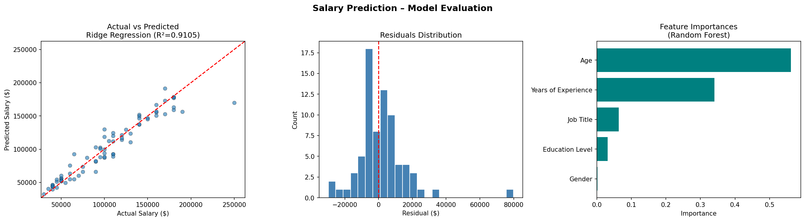

# SalaryAI 💼🤖

An end-to-end Machine Learning pipeline to predict professional salaries based on demographic and employment features including Age, Experience, Education Level, and Job Title.



---

## 📌 Project Overview

**SalaryAI** trains and compares multiple regression algorithms to accurately estimate salaries based on real-world workforce demographics:
- **Ridge Regression**
- **Random Forest Regressor**
- **Gradient Boosting Regressor**

The pipeline includes automated data preprocessing, missing value imputation, one-hot encoding for categorical variables, feature scaling, 5-fold cross-validation, and evaluation visualizations.

---

## 📊 Dataset

- **File**: `data/Salary Data.csv`
- **Samples**: 375 records (373 valid samples after target cleaning)
- **Features**:
  - `Age` (Numerical)
  - `Gender` (Categorical: Male, Female)
  - `Education Level` (Categorical: Bachelor's, Master's, PhD)
  - `Job Title` (Categorical)
  - `Years of Experience` (Numerical)
- **Target Variable**:
  - `Salary` ($) — Mean: ~$100,577 | Range: $350 – $250,000

---

## 📈 Benchmark & Results

Evaluated on an 80/20 train-test split with 5-fold cross-validation:

| Model | MAE ($) | RMSE ($) | R² Score | 5-Fold CV R² |
| :--- | :---: | :---: | :---: | :---: |
| **Ridge Regression (Best)** | **$9,824** | **$14,646** | **0.9105** | **0.8896 ± 0.0700** |
| Random Forest Regressor | $10,121 | $17,551 | 0.8715 | 0.8642 ± 0.0918 |
| Gradient Boosting Regressor | $10,731 | $17,943 | 0.8657 | 0.8762 ± 0.0778 |

### 🔍 Key Insights & Feature Importance (Random Forest)
1. **Age**: ~56.2%
2. **Years of Experience**: ~34.1%
3. **Job Title**: ~6.4%
4. **Education Level**: ~3.1%
5. **Gender**: ~0.2%

*Age and Years of Experience are the dominant drivers of compensation.*

---

## 🛠️ Project Structure

```bash
salaryai/
├── data/
│   └── Salary Data.csv        # Dataset
├── salary_model.py            # Complete ML pipeline & evaluation script
├── salary_model_results.png   # Generated evaluation plots
├── requirements.txt           # Python dependencies
├── .gitignore                 # Ignored files & environments
└── README.md                  # Project documentation
```

---

## 🚀 Getting Started

### 1. Clone the Repository
```bash
git clone https://github.com/RaghuramSRM/salaryai.git
cd salaryai
```

### 2. Set Up Virtual Environment (Optional but recommended)
```bash
python -m venv venv
# Windows:
venv\Scripts\activate
# macOS/Linux:
source venv/bin/activate
```

### 3. Install Dependencies
```bash
pip install -r requirements.txt
```

### 4. Run the Pipeline
```bash
python salary_model.py
```

This will preprocess the data, train and benchmark all models, print sample predictions, and save the evaluation plot to `salary_model_results.png`.

---

## 📄 License
This project is open-source and available under the [MIT License](LICENSE).
